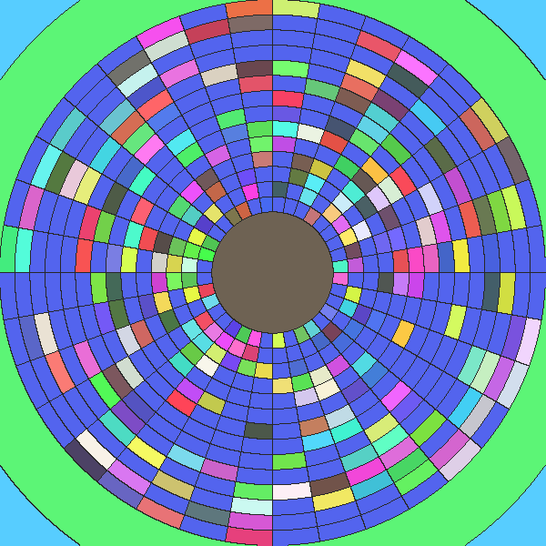
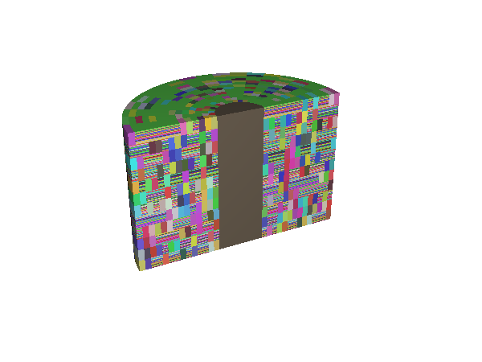
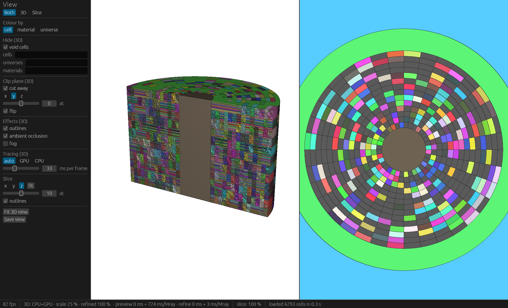

# llevant

Fast, exact geometry queries on MCNP models, in Rust. llevant answers:

- where points are, and what lines cross;
- slices and 3D views;
- volumes, and the gaps and overlaps of a model;
- fingerprints that tell two versions of a model apart.

It reads the MCNP input (through [migjorn](https://crates.io/crates/migjorn)), and
handles every universe level, lattice and transform. It is checked point by point
against MCNP 6.2, with no disagreement so far.

On a 425 k-cell fusion reactor model, on a 16-thread laptop
([`docs/benchmarks.md`](docs/benchmarks.md)):

| | |
|---|---|
| Load | 1.3 s from the cache (36 s to compile the first time) |
| Points | 5.4 million classified per second |
| Lines | 3.3·10⁵ lines of 100 cm traced per second |
| Slices | 110 ms for 1000 rows |
| Gaps and overlaps | the 36 × 37 × 35 m building checked on lines 5 cm apart in under 3 minutes |
| Viewer | 60 fps while orbiting (GPU) |

| Slice (`llevant slice`) | Cutaway view (`llevant render --clip`) |
|---|---|
|  |  |

## What it does

| Query | Command | Library |
|---|---|---|
| Where points are: cell path, material, density; gaps, overlaps, on-surface | `locate` | `Model::classify` |
| What lines cross: exact segments, the surface at each end | `trace` (`--lines` for a file of them) | `Model::trace` |
| 2D slices with exact boundaries, cell and surface labels | `slice` | `Model::slice`, `llevant_render::labels` |
| 3D views: hidden cells, cutaways, universe levels, ghost shells | `render` (`--gpu`) | `Model::render`, `Model::first_hits`, `llevant-gpu` |
| Realistic images: materials sorted by composition, physically based shading | `render --colour realistic`, `materials` | `llevant_scene::materials`, `llevant_render::shading` |
| Volumes by cell, material, universe or tally bin, with an honest uncertainty | `volume` | `Model::volumes`, `volumes_to`, `instance_volumes` |
| Gaps and overlaps, with volume and location | `check` | `Volumes::problems` |
| Fingerprints of cells and universes; model diffs | `fingerprint` | `Model::fingerprints` |
| A universe (a filler) as a model of its own | `--universe` | `Model::universe` |
| Cell instances: each place a cell occupies, numbered | `locate` | `Model::instances` |
| Results over the geometry: values per cell, instance or mesh voxel (CSV, meshtal, MCTAL, D1SUNED cuvmsh) | `slice`/`render --field` | `llevant_scene::field` |
| An interactive viewer: 3D view and slice, picking, rules, cuts, fields, FMESH layout | `llevant-viewer`, `llevant view` | `crates/llevant-viewer` |
| Python: models kept in memory, numpy batch queries, inline images, the viewer | `python -m llevant` | `crates/llevant-py` |

## Start

```sh
cargo install llevant-cli                        # `llevant`; --features gpu,viewer for the GPU and `llevant view`
cargo install llevant-viewer                     # `llevant-viewer`
pip install llevant                              # Python, with the GPU and the viewer
```

```sh
llevant info   model.mcnp                     # sizes, extent, diagnostics
llevant locate model.mcnp 0 0 0  120 -3.5 40  # cell path, material, density of each point
llevant slice  model.mcnp --plane z=37 --colour material -o slice.png
llevant render model.mcnp --clip 0,0,0,0,-1,0 --colour realistic -o view.png
llevant check  model.mcnp --h 2               # exit status 1 if gaps or overlaps
llevant-viewer model.mcnp                     # or: python -m llevant view model.mcnp
```

Guides: [command line](docs/guide/cli.md) (with [scripting and agents](docs/guide/cli.md#scripting-and-agents)), [Python](docs/guide/python.md),
[viewer](crates/llevant-viewer/README.md).



The viewer shows a 3D view and an exact slice side by side, and stays smooth however
big the model is:

- the 3D view is traced on the GPU, and while the camera moves, the hits already
  traced are moved to it every frame;
- anything that scales with the model runs off the UI thread.

Without a GPU it traces on the CPU.

## Library

```rust,no_run
use llevant::{Depth, Line, Model, Options, Status, DEFAULT_PRECISION};

fn main() -> Result<(), Box<dyn std::error::Error>> {
    let model = Model::load("model.mcnp", &Options::default(), None)?;
    let res = model.classify(&[[0.0, 0.0, 0.0], [120.0, -3.5, 40.0]], Depth::All);
    for &id in &res.ids {
        let label = &res.labels[id as usize];
        println!("{}", model.describe(label)); // e.g. "inside 12 > 304[1,-2,0] > 7"
        if label.status == Status::Inside {
            let cell = model.cell(label.cell().unwrap());
            println!("cell {} material {} density {}", cell.id, cell.material, cell.density);
        }
    }

    let line = Line::between([-100.0, 0.0, 0.0], [100.0, 0.0, 0.0]);
    let tr = model.trace(&[line], Depth::All)?;
    for k in tr.segments(0) {
        let out = model.surface_id(tr.surface_out[k]); // MCNP surface (and facet), if any
        let label = &tr.labels[tr.ids[k] as usize];
        println!("{} .. {}: {} -> {out:?}", tr.t0[k], tr.t1[k], model.describe(label));
    }

    let fp = model.fingerprints(DEFAULT_PRECISION)?; // fp.cells[i].geometry, fp.units[u].content
    println!("{} cells fingerprinted", fp.cells.len());
    Ok(())
}
```

- **Batches.** Queries take batches and return flat arrays, ready for numpy: one
  label id per point or segment, with the labels interned.
- **Indices and numbers.** Labels refer to cells by index into `model.cells()`;
  `describe`, `cell_id` and `surface_id` give MCNP numbers.
- **Determinism.** Results are identical for any number of threads.
- **Errors.** Bad arguments are an `Error`, never a panic.

[`docs/contracts.md`](docs/contracts.md) lists what each query guarantees. Views,
volumes and images:

```rust,no_run
use llevant::{Camera, Depth, Model, Options, Scope, Slice, Visibility, VolumeGrid};
use llevant::Axis;
use llevant_render::{colours::{ColourBy, Paint}, png::write_png, shading};
use llevant_scene::materials::Looks;

fn main() -> Result<(), Box<dyn std::error::Error>> {
    let model = Model::load("model.mcnp", &Options::default(), None)?;
    let region = model.extent(Scope::Contents, 128); // measured box around the contents
    let slice = Slice::axis(Axis::Z, 37.0, &region, 1000); // the plane z = 37
    let ids = slice.pixels(&model.slice(&slice, Depth::All)?); // label id per pixel
    println!("{} pixels", ids.len());

    let vols = model.volumes(&VolumeGrid::seeded(region, 2.0, 1), None)?;
    for i in vols.problems() {
        println!("{}: {} cm3", model.describe(&vols.labels[i]), vols.volumes[i].estimate);
    }

    // Material looks are a value of their own: the model never changes.
    let looks = Looks::new(&model, &[(12, "copper roughness=0.2".parse()?)])?;
    let cam = Camera::fit(&region, [0.6, 0.7, -0.4], 800, 600);
    let hits = model.render(&cam, &Visibility::solid(&model))?;
    let probes = shading::Probe::from_hits(&model, &hits);
    let paint = Paint::new(&model, &looks, ColourBy::Realistic);
    let rgb = shading::render_image(&paint, &probes, &cam)?;
    write_png("view.png".as_ref(), 800, 600, &rgb)?;
    Ok(())
}
```

## What is supported

- **Surfaces**:
  - P (4 coefficients or 3 points), PX/PY/PZ, SO/S/SX/SY/SZ;
  - C/X/C/Y/C/Z and CX/CY/CZ;
  - K/X/K/Y/K/Z and KX/KY/KZ (one or two sheets);
  - SQ, GQ;
  - TX/TY/TZ, including degenerate A = 0;
  - X/Y/Z by points;
  - periodic surfaces (`n -m type ...`).
- **Macrobodies** RPP, BOX, SPH, RCC, TRC, RHP/HEX, REC, ELL, WED and ARB, as whole
  bodies or facets `n.k`.
- **Transforms and cell forms**:
  - `TRn`/`*TRn` (3, 9, 12 or 13 entries, `m = ±1`);
  - inline `FILL` transforms and `*FILL`;
  - `TRCL`/`*TRCL`, inline or by number;
  - `U` and nested fills;
  - complements `#n` and `#( )`;
  - `LIKE n BUT`.
- **Lattices** `LAT=1` (any parallelepiped) and `LAT=2` (hexagonal prisms), 2-D or
  3-D:
  - filled uniformly or by a fill array, with `nR` repeats and per-element
    transforms;
  - elements may be filled by the lattice cell itself.
- **MCNP's own restrictions** are mirrored as errors on the cell. MCNP's behaviours
  found along the way are in [`docs/mcnp-behaviour.md`](docs/mcnp-behaviour.md).

## Layout

| Path | Purpose |
|---|---|
| `crates/llevant` | The engine (pure Rust, geometry only) |
| `crates/llevant-scene` | What frontends build from a model: cell rules, hidden cells, material looks, field data and tally files, the input's cards, the cache of compiled models |
| `crates/llevant-render` | Images: colours, colour scales, field looks, physically based shading, labels, PNG |
| `crates/llevant-gpu` | The GPU renderer (wgpu) |
| `crates/llevant-viewer` | The `llevant-viewer` desktop app and its egui widgets |
| `crates/llevant-cli` | The `llevant` command |
| `crates/llevant-py` | The Python module `llevant` (PyO3, abi3 wheels) |
| `tools/bench` | `llevant-bench`: benchmarks, checks against brute force and of the GPU against the CPU |
| `tools/mcnp-oracle` | Checks llevant against MCNP itself |
| `tools/synthetic` | Generators of benchmark models |
| `docs/` | [Architecture](docs/architecture.md), [contracts](docs/contracts.md), [decisions](docs/decisions/README.md), [benchmarks](docs/benchmarks.md), [internals](docs/internals/engine.md) |

## Develop

[`CONTRIBUTING.md`](CONTRIBUTING.md) has the commands, the rules and how to check
against MCNP.

```sh
cargo test --release                       # unit, MCNP golden, property and CLI tests
cargo test --release -p llevant-gpu -p llevant-viewer   # GPU renderer and viewer (skip without an adapter)
cargo run --release -p llevant-bench       # benchmarks and checks: every command
```

Licence: EUPL-1.2.
