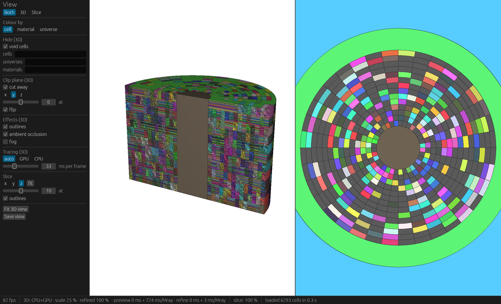

# llevant-viewer

Interactive viewer of MCNP models on [llevant](https://github.com/Fusion4Energy/llevant):
a 3D view and an exact 2D slice side by side. A desktop app (`llevant-viewer`) and a
library of egui widgets other Rust programs can embed.



```sh
cargo install llevant-viewer                      # or --path crates/llevant-viewer in a checkout
llevant-viewer model.mcnp
llevant-viewer model.mcnp --state view.json       # open at a saved view
llevant-viewer model.mcnp --backend cpu           # auto (default), gpu or cpu
```

Using the viewer: the [viewer guide](https://fusion4energy.github.io/llevant/guide/viewer/)
and the [full reference](https://fusion4energy.github.io/llevant/reference/viewer/)
(controls, panels, the view file), from `docs/guide/viewer.md` and
`docs/reference/viewer.md`. This page is for Rust programs that embed the views, and
for work on the viewer itself.

## Embedding the views

The views are egui widgets on eframe 0.36 with the wgpu renderer.
[`examples/embed.rs`](examples/embed.rs) is a complete small app with both
(`cargo run --release -p llevant-viewer --example embed -- model.mcnp`). Its
parts:

```rust
// Open the window with the viewer's device settings: the adapter's own limits
// (big models need large buffers), Vulkan first.
let options = eframe::NativeOptions {
    renderer: eframe::Renderer::Wgpu,
    wgpu_options: llevant_viewer::app::wgpu_options(),
    ..Default::default()
};

// In the app creator: the window's device makes the views' images...
let rs = cc.wgpu_render_state.clone().unwrap();
let window_gpu = Arc::new(Gpu::from_parts(rs.device.clone(), rs.queue.clone(), rs.adapter.get_info()));
// ...and the GPU renderer gets a device of its own, so that its jobs do not
// queue in front of the window's frames, traced in slices short enough for them.
let trace_gpu = Arc::new(Gpu::from_adapter(&rs.adapter, TIMESTAMPS)?);
let mut gm = GpuModel::upload(&trace_gpu, &model)?;
beside_window(&mut gm);
let gm = Arc::new(gm);
gm.set_visibility(&trace_gpu, &model, &vis)?;
let backend = GpuBackend::new(trace_gpu, gm, model.clone());
// What materials look like (realistic colours): owned by the app, shared by the views.
let looks = Arc::new(Looks::new(&model, &[])?);
let mut view = View3d::new(window_gpu, model.clone(), looks.clone(), Box::new(backend), &vis, 0.033, ColourBy::Cell);
let orbit = Orbit::fit(&region, 35.0, 25.0);
let mut slice = SliceView::new(model, looks, region, &SliceState::default(), ColourBy::Cell);

// Each frame. 3D: give the camera the size of its rectangle in physical pixels,
// draw the texture `frame` returns, repaint while it works.
if let Some(tex) = view.frame(&rs, orbit.camera(w, h, None)) {
    ui.painter().image(tex, rect, uv, egui::Color32::WHITE);
}
if view.busy() {
    ui.ctx().request_repaint();
}
// The slice takes the rest of its ui; events.hovered and events.clicked are
// points in cm.
let events = slice.ui(ui);
```

`View3d` also has `set_visibility`, `set_colouring`, `set_looks`, `set_field` (a
`llevant_render::field::Field` drawn over the cells; `SliceView::set_field` too), `set_selection`
(tint and outline a set of cells), `hover` (outline one), `set_effect` and `stats`
(`SliceView` has `set_selection` and `hover` too), and `render_now(camera)` traces a whole view at once
without a window and returns its RGBA pixels. `pick::pick_ray` and
`pick::pick_point` give what is under the cursor, exactly; `SliceView::ui` returns
the plane it shows (`PlaneView`, to map points to the screen and back) with the
pointer's response, and `viewport::ViewPort` does the same for either view, as the
application's tools use it. `ViewerApp` (`app/`) puts all of it together ("Inside
the application" below).

## Writing an effect

Effects are compute shaders run after the hits of every pixel are known. A pass is
WGSL defining one function, the colour of pixel `p`. From `examples/embed.rs`:

```rust
let gpu = view.gpu().clone();
view.passes().push(
    &gpu,
    Box::new(WgslPass {
        name: "depth tint".into(),
        source: r#"
fn effect(p: vec2<i32>) -> vec4<f32> {
    let c = source(p);
    if !hit_any(p) {
        return c;
    }
    let d = clamp(hit_t(p) / F.eye.w, 0.0, 1.0);
    return vec4<f32>(mix(c.rgb, F.params[0].xyz, d * 0.5), c.a);
}
"#
        .into(),
        params: [0.2, 0.3, 0.8, 0.0, 0.0, 0.0, 0.0, 0.0, 0.0, 0.0, 0.0, 0.0],
    }),
    true, // enabled
)?;
view.set_effect("depth tint", false); // and on again with `true`
```

`push` compiles the shader at once: WGSL that does not compile comes back as an
`Err` with the compiler's message, and the pass is not added. Passes run in order,
each reading the previous one's image. The first, `colour`, makes the base image
and is always on; `field` (on with a field), `outline` and `ambient_occlusion` are
the built-in ones.
After all of them `highlight` tints and outlines the
selection and outlines the cell under the pointer.
For a pass with settings, implement the `PostPass` trait (`name`, `wgsl`,
`params`). A pass that needs data of its own (a lookup table, values per cell)
says how many storage buffers it reads (`data_buffers`), declares them in its WGSL
as `@group(1) @binding(k) var<storage, read> ...`, and is given their bytes with
`view.passes().set_data(&gpu, name, &[bytes])` (one zero word each until then);
`insert` puts a pass anywhere after the first. The built-in `field` pass
(`view3d/field.rs`) is one. WGSL may assume floats are never NaN: test "no value"
on the bits, not with `v != v`. What a pass can use (from
[`shaders/prelude.wgsl`](src/view3d/shaders/prelude.wgsl)):

| WGSL | Gives |
|---|---|
| `source(p)` | the previous pass's colour (8-bit sRGB values as fractions) |
| `hit_any(p)` | whether the ray stopped at something (a cell, a gap, a problem) |
| `hit_status(p)` | `ST_INSIDE`, `ST_GAP`, `ST_PROBLEM`, `ST_MISS`, `ST_STEPS`, `ST_TOO_DEEP` |
| `hit_t(p)`, `hit_point(p)`, `ray_dir(p)` | distance from the eye (cm), the point hit, the ray direction |
| `hit_normal(p)` | unit normal facing the ray; zero when the ray starts inside a cell |
| `hit_cell(p)`, `hit_top_cell(p)` | deepest and level-0 cell (index into the model's cells) or `NONE` |
| `hit_instance(p)` | which instance of the deepest cell (`llevant::Instances`), or `NONE` |
| `cell_colour(cell)` | the cell's colour for the current colouring |
| `is_selected(cell)` | whether the cell is selected |
| `size()`, `in_image(q)` | image size; whether pixel `q` is inside it |
| `F.params[0]`, `F.params[1]` | the pass's eight numbers |
| `F.eye`, `F.fwd`, `F.right`, `F.up` | camera (`F.eye.w`: ray reach, `F.fwd.w`: tan of half the field of view) |
| `F.background`, `F.size.z` | background colour; the cell under the pointer or `NONE` |

## Develop

```sh
cargo test --release -p llevant-viewer   # scene, history, view file, images against `llevant render`, the app
LLEVANT_VIEWER_TEST_PNG=app.png cargo test --release -p llevant-viewer --test app   # + the final window as a PNG
llevant-viewer model.mcnp --screenshot out.png             # PNG of the window once traced, then quit
llevant-viewer model.mcnp --orbit 10 --screenshot out.png  # frame times while orbiting 10 s and while refining
RUST_LOG=llevant_viewer=debug llevant-viewer model.mcnp    # time of each traced batch, load steps
cargo run --release -p llevant-viewer --example latency -- model.mcnp    # GPU time against image size
```

The image tests compare the composed image with `llevant_render::shading::render_image` on
the MCNP zoo models: equal on every pixel with the CPU backend, and with the GPU
backend on the test views. `tests/app/` drives the whole application headlessly
(egui_kittest; `explore.rs`, `views.rs`, `results.rs` and `editing.rs`, with the helpers
in `main.rs`): it opens a zoo model, pins points from the right-click menu, picks in 3D
and checks the pick against the CPU engine, undoes and redoes from the keyboard and
the menu bar's row, selects through the inspector's links, hides and isolates from the
keyboard, opens the context menu and snaps the view with the axes. Both need a GPU
adapter (lavapipe is enough) and skip without one.

## Inside the application

The application grows by tools and panels around one document, so that a feature
touches the files of its own and not a central one:

| File | Holds |
|---|---|
| `scene.rs` | `Scene`: what is shown (colours, hidden cells, clip, effects, materials, pins, the field); the view file's top-level fields |
| `command.rs` | `Edit`s of the scene and the `History` that undoes them (whole scenes; edits of a slider merge); `Command`s for the rest |
| `document.rs` | `Document`: model and its index, looks, scene, selection, the point inspected, what is under the pointer, pins located, the field (read on a thread, kept per source), the two views; `execute(Command)` updates only what the change touches (visibility, looks, colours, effects, the field; the selection and the hovered cell are drawn without tracing) and refuses an edit the model cannot show |
| `selection.rs` | `Selection`: a rule and its cells, combined by click modes, with back and forward; the box to frame it |
| `context.rs` | links to cells, universes and materials, their menus, the views' right-click menu, the selection's keys |
| `tools/` | `Tool`: what the left button does over either view, sending commands and drawing its overlay; `Toolbox::standard()` lists them |
| `navigation.rs` | the 3D camera controls, whatever the tool (unless the tool takes the left drag) |
| `gizmo.rs` | the axes in the 3D view's corner that snap the view |
| `viewport.rs` | `ViewPort`: either view as tools and overlays see it: projection of model points, and the exact pick under a position |
| `overlay.rs` | pins and banners, the selection and the point a drag orbits about, over both views every frame |
| `panels/` | the tool row and the menu bar's controls (`toolbar.rs`), the views' headers (`headers.rs`) and their popups (`view_settings.rs`), the inspector (`inspector/`: its pages, cards read as words in `tokens.rs`, cards edited by fields in `fields.rs`, the geometry editor in `geometry.rs`); `marks.rs`: surfaces traced on the slice, Find (`find.rs`), materials, saved views, pins, fields, status bar, the command palette, the keys window |
| `theme.rs` | fonts, the dark and light palettes, overlay colours, house widgets (sections, choices, markers, banners) |
| `icons.rs` | the Lucide glyphs the interface uses (a new icon is one constant) |
| `app/` | `ViewerApp`: loading in the background (the model, and the input's cards beside it; `models.rs`, `loading.rs`), running the frame's commands (`commands.rs`), editing and saving the input (`editing.rs`); `input_edits.rs` the cards edited here (undo, saved or not); `frame.rs` the workspaces and their layout, `menu.rs` the menu bar; `devtools.rs` the screenshot and orbit hooks |
| `state.rs` | `ViewState`, the view file |
| `camera.rs`, `pick.rs`, `slice/`, `view3d/` | the orbit camera, exact picking, and the two view widgets (`view3d/`: `budget.rs` the scheduler, `backend.rs` CPU, GPU and both, `passes.rs` the effects, `field.rs` the field's pass, `edits.rs` the marks of a geometry being edited, `shaders/`) |

The rules: panels and tools read the document and send commands, which run after
the frame's interface is laid out; whatever changes the scene is an `Edit` (and so
undoable and saved); navigation (camera, slice plane) moves the views directly.
A new tool implements `Tool` (`input`, `overlay`) and goes in
`Toolbox::standard()`; a new panel is a function or struct in `panels/`, shown
as a `Panel` of a workspace (`app/frame.rs`). Anything a tool needs from the engine (slices at any angle,
several cut regions) is an engine feature, tested there.
