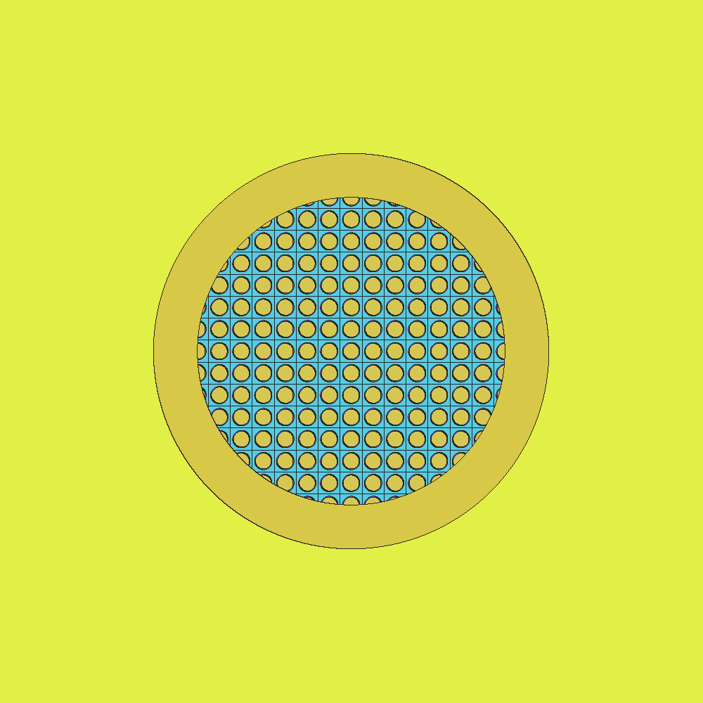
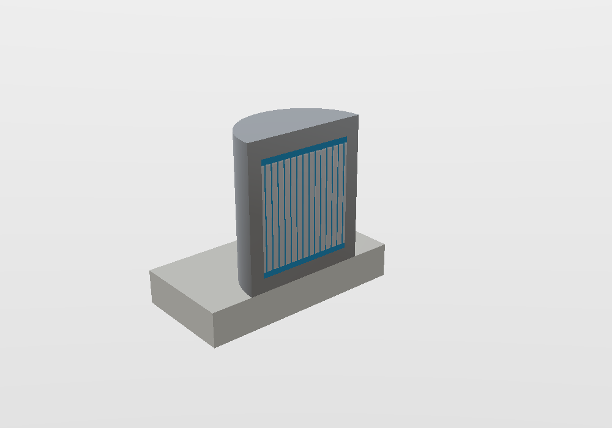
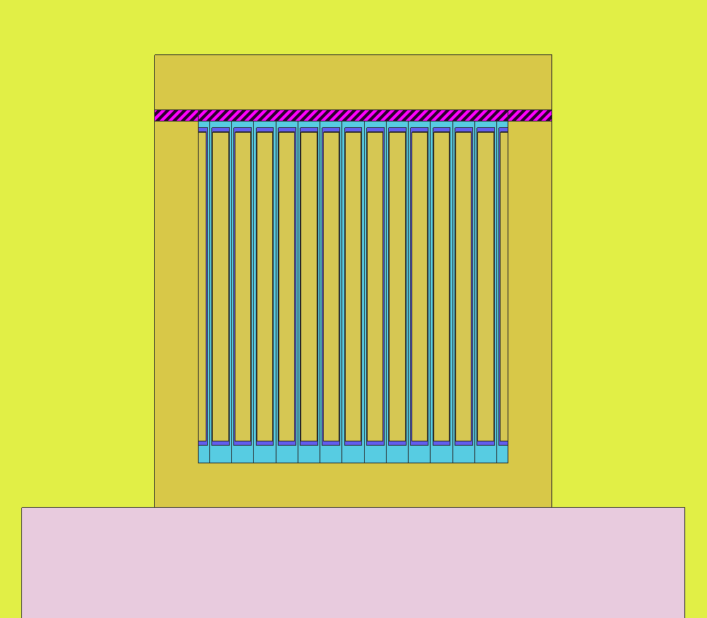

# Getting started

A ten-minute tour on a small example: a steel cask full of fuel pins, standing on a
concrete floor. You need llevant [installed](install.md) and a terminal (on Windows,
*Command Prompt* or *PowerShell*).

## 1. Get the example

Download these two files into a folder of your choice:

- [`cask.i`](examples/cask.i): the model;
- [`cask-v2.i`](examples/cask-v2.i): the same model with a mistake in it.

??? info "What is in the model"

    | Cell | What | Material |
    |---|---|---|
    | 1 | concrete floor | m5, concrete |
    | 2, 3 | cask body and lid | m4, steel |
    | 4 | the cavity, filled with universe 1 | (filled) |
    | 30 | universe 1: a square lattice, 10 cm pitch, filled with universe 2 | (filled) |
    | 41, 42, 43 | universe 2: one pin: fuel, cladding, water | m2, m3, m1 |
    | 5 | air around it all | m6, air |
    | 6 | the outside world | `IMP:N=0` |

Open a terminal in that folder. In the commands below, `llevant` can always be
replaced by `python -m llevant` if you installed with pip.

## 2. Look at it in the viewer

```sh
llevant view cask.i
```

(or `llevant-viewer cask.i` if you downloaded the programs). The window shows the 3D
view on the left and a slice on the right.

1. At first you see a box: it is the air (cell 5), around everything. **Click** on it
   to select it, then press **H** to hide it. Now you see the floor and the cask.
2. Turn the model with the **middle mouse button** (drag), move towards a point by
   **scrolling** over it, and slide with the **right button**.
3. **Double-click** anything: the inspector, on the right, says which cell it is, its
   material and density, and the path down through the universes
   (`4 > 30[1,0,0] > 41`: cell 41, in lattice element (1, 0, 0) of cell 30, in cell 4).
4. In the slice, click **y** in its header to slice through the side of the cask.
   Scroll to zoom, drag with the right button to pan.
5. Open **Section** above the 3D view and **+ plane** to cut the model open.

Press **F1** to see every key and mouse action. The [viewer guide](guide/viewer.md)
tells you more.

## 3. The same from the command line

The viewer is one way in. The `llevant` command answers the same questions without a
window, which is handy for scripts, reports and big batch jobs.

**A summary of the model:**

```sh
llevant info cask.i
```

```text
cells       10
surfaces    33 (compiled, macrobody facets apart)
universes   3
lattices    1
...
diagnostics 0
```

**Which cell is at a point?** Give x y z in cm, as many points as you like:

```sh
llevant locate cask.i  0 0 100   80 0 100   0 0 -10
```

```text
0 0 100: inside 4 > 30[0,0,0] > 41  material 2 density -10.4  instance 343
80 0 100: inside 2  material 4 density -7.9  instance 1
0 0 -10: inside 1  material 5 density -2.3  instance 0
```

The first point is in the fuel (cell 41) of the pin at lattice element (0, 0, 0); the
second in the cask body; the third in the floor.

**A slice**, as an image (`--region` frames it: two corners, in cm):

```sh
llevant slice cask.i --plane z=100 --region -160,-160,-50,160,160,230 --colour material -o slice.png
```

{ width="420" }

**A 3D view, cut open.** `--hide 5` hides the air, `--clip` cuts the model with a
plane (a point, then the direction of the side cut away), and `--colour realistic`
colours each material by what it is made of:

```sh
llevant render cask.i --hide 5 --clip 0,0,0,0,-1,0 --colour realistic \
    --region -160,-160,-50,160,160,230 -o cutaway.png
```

{ width="560" }

!!! tip "Long commands"

    The `\` at the end of a line continues the command on the next line (Linux). On
    Windows, type it all on one line.

## 4. Find a mistake

`cask-v2.i` has its lid 5 cm lower, so that it overlaps the body and the cavity.
`check` finds gaps and overlaps by tracing lines through the whole model (`--h 2`: the
lines are 2 cm apart):

```sh
llevant check cask.i --h 2
```

```text
no gaps or overlaps found (h = 2 cm)
```

```sh
llevant check cask-v2.i --h 2
```

```text
overlap (3, 4): 7.6960e4 ± 3.2e1 cm3 in [-70.000, -70.000, 175.000] .. [69.999, 70.000, 180.000]
overlap (2, 3): 5.0251e4 ± 2.6e1 cm3 in [-89.996, -90.000, 175.000] .. [90.000, 90.000, 180.000]
```

Each line names the cells that overlap, how big the overlap is and where it is. A
slice through it shows it hatched in magenta (gaps are black):

```sh
llevant slice cask-v2.i --plane y=0.5 --region -160,-160,-50,160,160,230 --colour material -o overlap.png
```

{ width="420" }

!!! note "Why y = 0.5 and not y = 0?"

    A slice that lies exactly on a surface shows that surface in grey (the points on
    it are on the surface, in no cell). Real models have many surfaces at round
    numbers: move the slice a little off them.

## 5. Compare two versions

Which cells changed between the two files?

```sh
llevant fingerprint cask.i --diff cask-v2.i
```

```text
cells: 8 unchanged, 2 differences
  cell 3: geometry changed
  cell 5: geometry changed
...
```

The lid (cell 3) moved, and so did the air around it (cell 5). The comparison ignores
cell numbers and card order, so it still works after cells are renumbered.

## 6. Volumes

```sh
llevant volume cask.i --h 1 --by material
```

```text
    material   volume (cm3)        sigma       rel
           0    8.817261e-2     4.083e-6   4.63e-5
           1     1.355243e6      3.501e1   2.58e-5
           2     8.702718e5      2.115e1   2.43e-5
           ...
```

`sigma` is the uncertainty of each volume (one standard deviation): halve `--h` for
a smaller one. Material 0 is void; the tiny void volume here is the outside world,
caught at the very edge of the box that is measured.

## 7. From Python

The same questions from Python, where the model stays loaded between questions:

```python
import llevant

m = llevant.load("cask.i")
p = m.locate(0, 0, 100)
print(p, p.cell, p.material)          # inside 4 > 30[0,0,0] > 41   41 2
print(m.check(h=2))                   # []: no gaps or overlaps
print(llevant.load("cask-v2.i").check(h=2))
m.slice(y=0.5, colour="material").save("slice.png")   # in Jupyter, the image shows inline
```

## Next

- [How do I…?](how-to.md): the common jobs, step by step.
- The guides to [the viewer](guide/viewer.md), [the command line](guide/cli.md) and
  [Python](guide/python.md).
